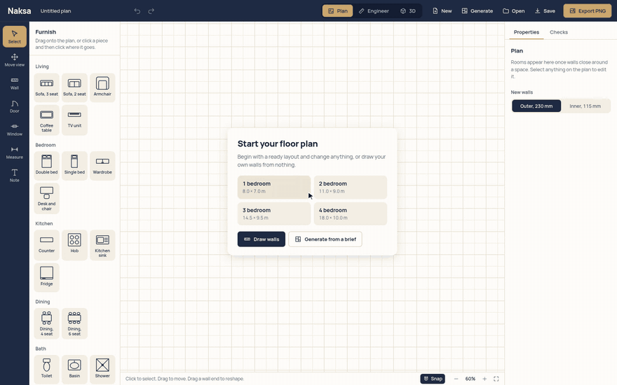
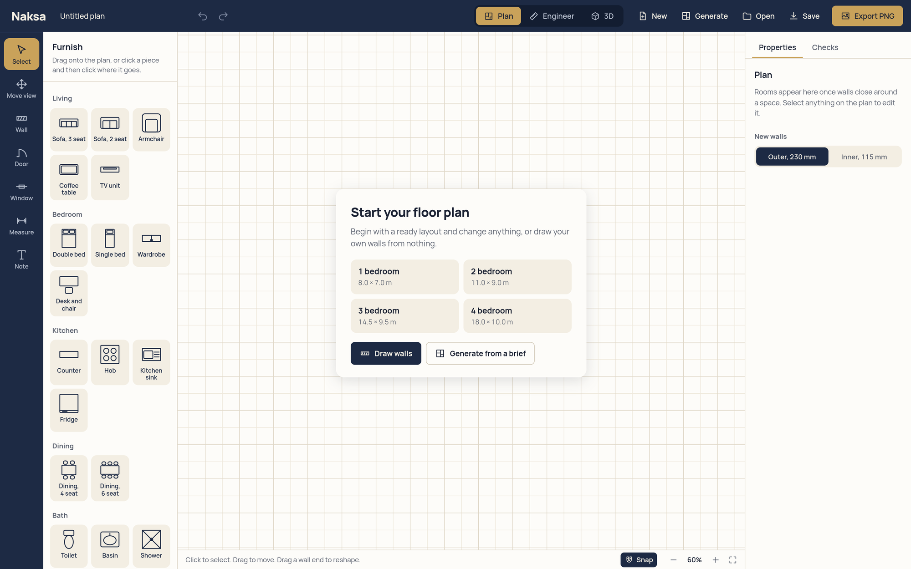
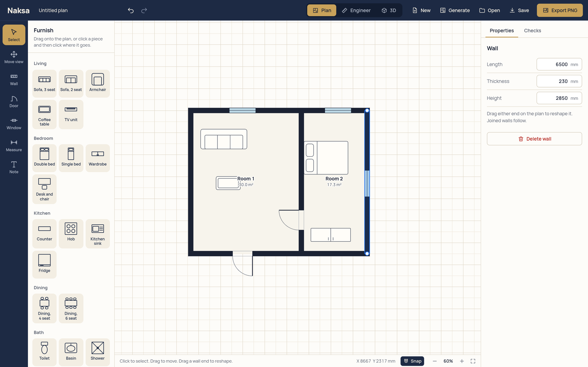
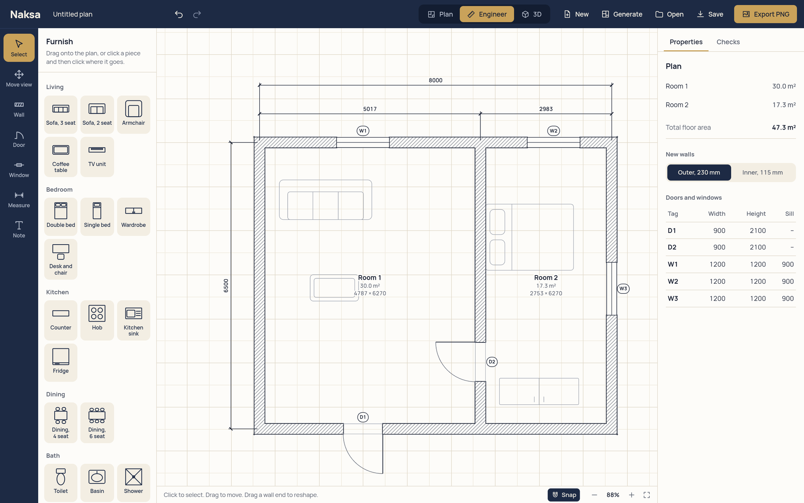
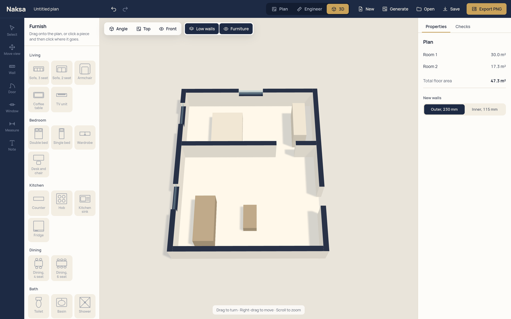
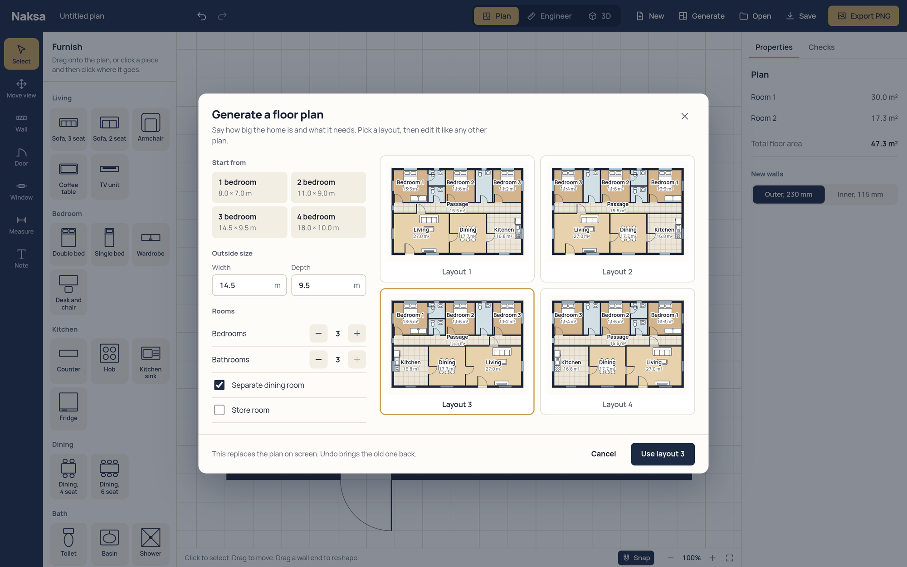
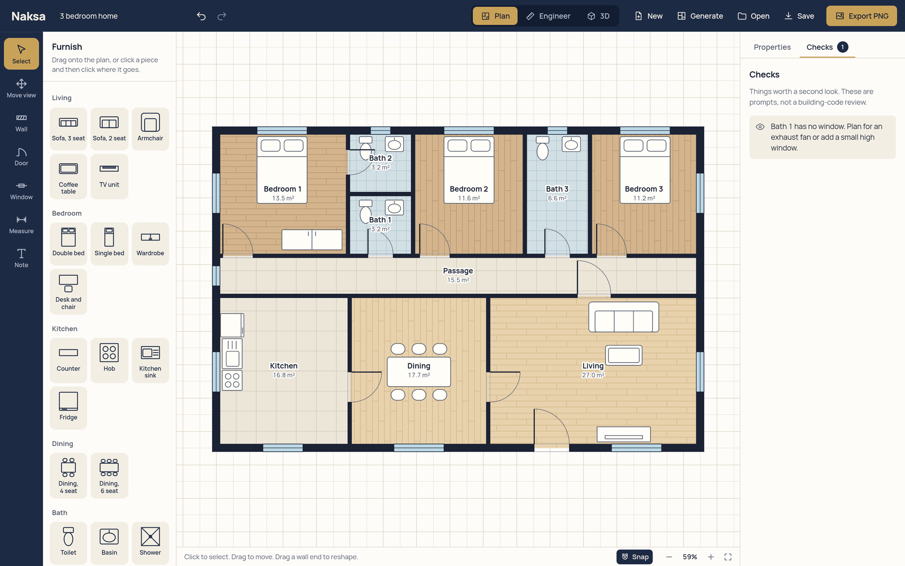
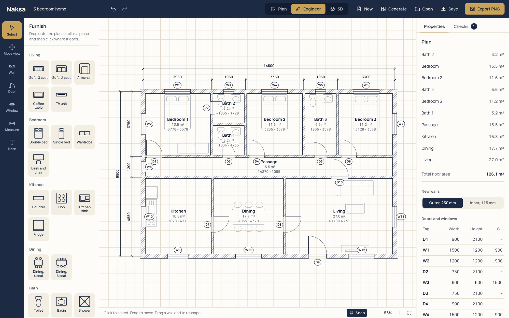
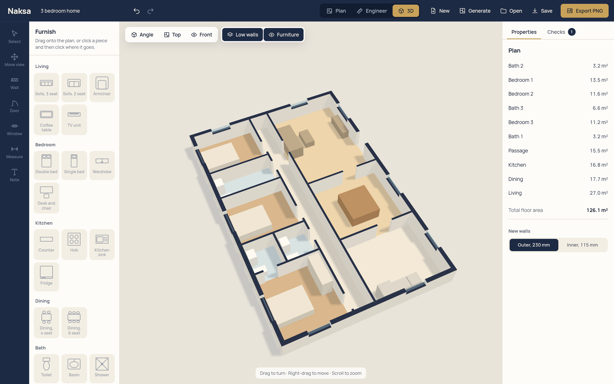

# Naksa

A floor plan generator and editor for the web. Draw walls, drop in doors, windows and furniture, or generate a whole layout from a short brief. Then view the same plan as a furnished drawing, an engineer’s drawing with dimensions and opening schedules, or a 3D model.

Built with Next.js, HTML Canvas 2D and three.js. The drawing, snapping, room detection, wall mitres, layout generation and export are self-written.

> **Note:** Naksa applies concepts and processes from my work at Quantrion, with responsible and permissive demonstration.

## Demo

Try it live at [naksa.robinpanta.com.np](https://naksa.robinpanta.com.np).

Drawing a room, adding doors, windows and furniture, switching to the engineer and 3D views, then generating a 3-bedroom home from a brief:



## Output

**Start screen.** Begin from a preset layout, draw walls from nothing, or generate from a brief.



**Hand-drawn plan.** Walls are drawn as a chain, rooms are detected with their areas, and doors, windows and furniture snap onto the plan. Selecting a wall shows its length, thickness and height in the inspector.



**Engineer view of the same plan.** Overall and per-room dimensions, hatched wall sections, door and window tags, and a schedule of openings.



**3D view with low walls**, so the furniture inside is visible:



**Generate from a brief.** Set the outside size, the number of bedrooms and bathrooms, and the optional rooms, then pick one of four layouts:



**Generated plan with checks.** The Checks tab points out things worth a second look, such as a bathroom without a window:



**Engineer view of the generated home:**



**Generated home in 3D:**



## Running locally

Naksa uses [Bun](https://bun.sh).

```sh
bun install
bun run dev
```

Then open http://localhost:3000.
